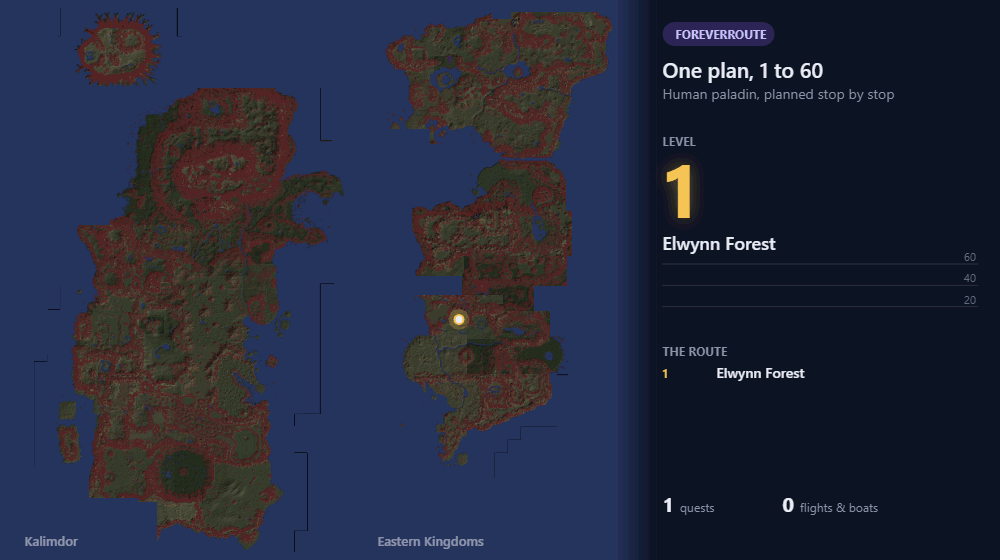
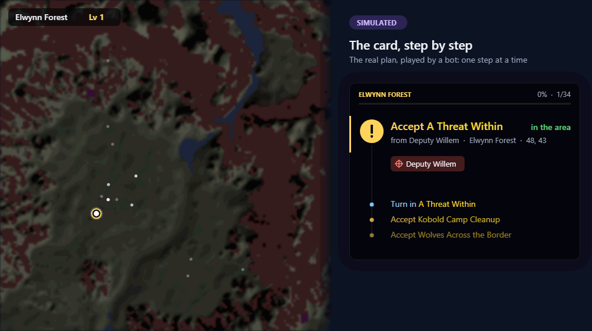
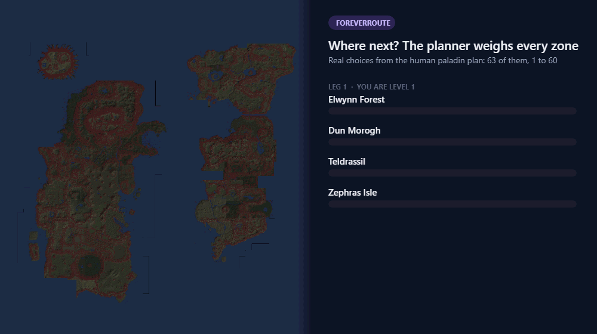
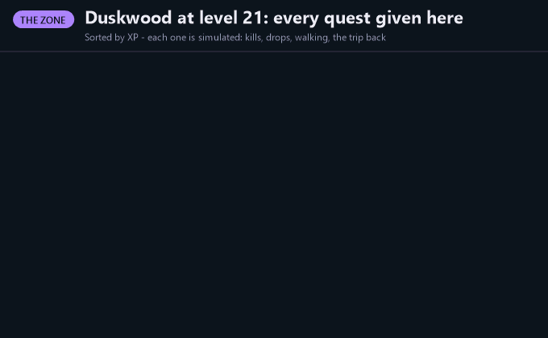
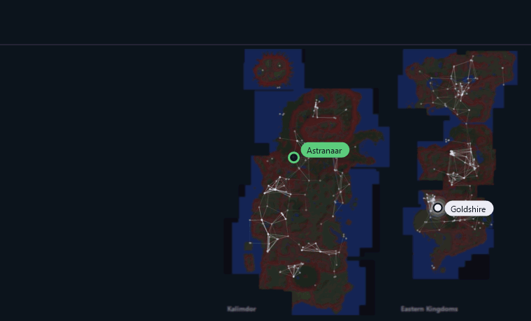
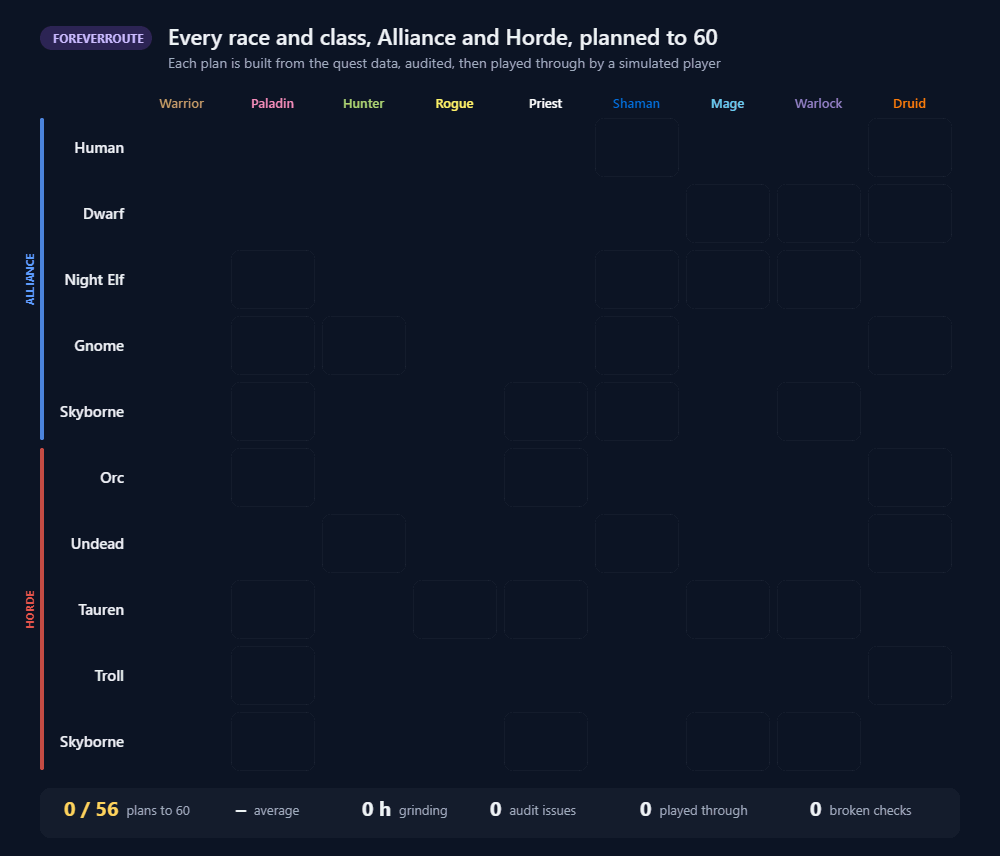

# Forever Route

Leveling routes for WoW Forever, 1-60, for every Alliance race and class. A step card, an arrow and map pins tell you
what to accept, kill, hand in, train and where to travel. Skip quests or dungeons and the route keeps up.

**The card tells you the next thing to do**, counts your kills and loot, and moves on by itself:

Routes aren't hand-written. A planner builds them from the quest data and the game's own terrain.

**It picks the next zone** by planning out every zone that fits your level and comparing xp per hour:

**It keeps the quests worth doing** - and says why the rest were cut or left for later:

**It finds the fastest way there** across one network of roads, boats, the tram, flights, class teleports and the
Skyborne skyship:

**Every plan is played 1-60 by ten simulated players before it ships:**

Optional: the Windows companion (see Releases) replans your route from your save every time you `/reload`.

Forever Route by noopz. [CC BY-NC-SA 4.0](LICENSE): share and adapt it with credit, never sell it. The quest data it is built from is GPL-3.0 (QuestieDB); see [NOTICE](NOTICE). Contributions: [CONTRIBUTING.md](CONTRIBUTING.md).
