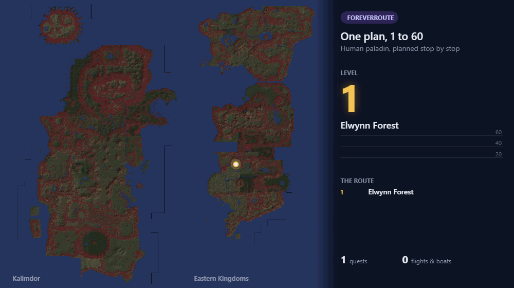
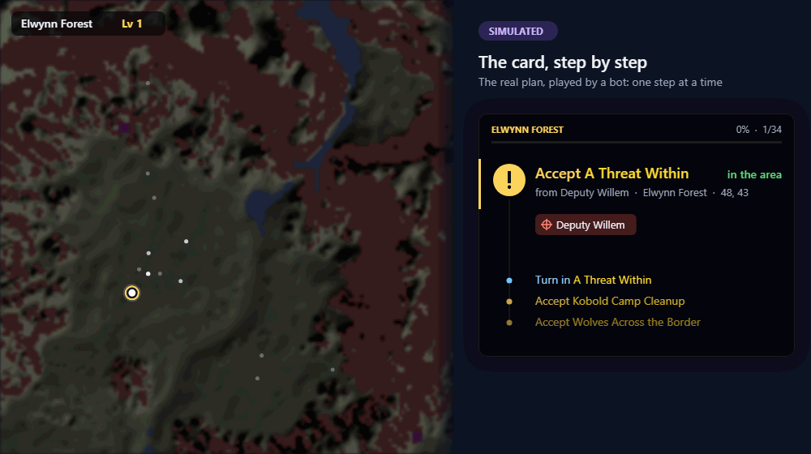
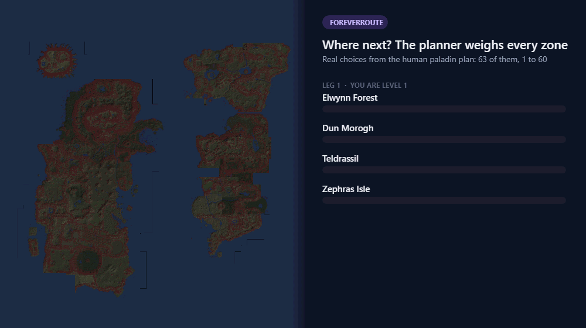
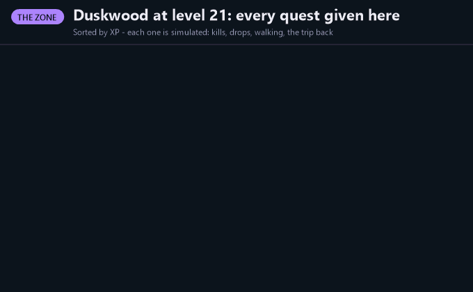
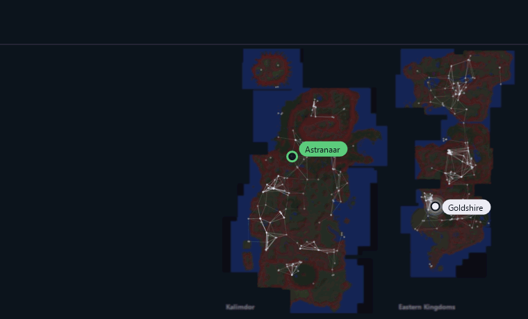
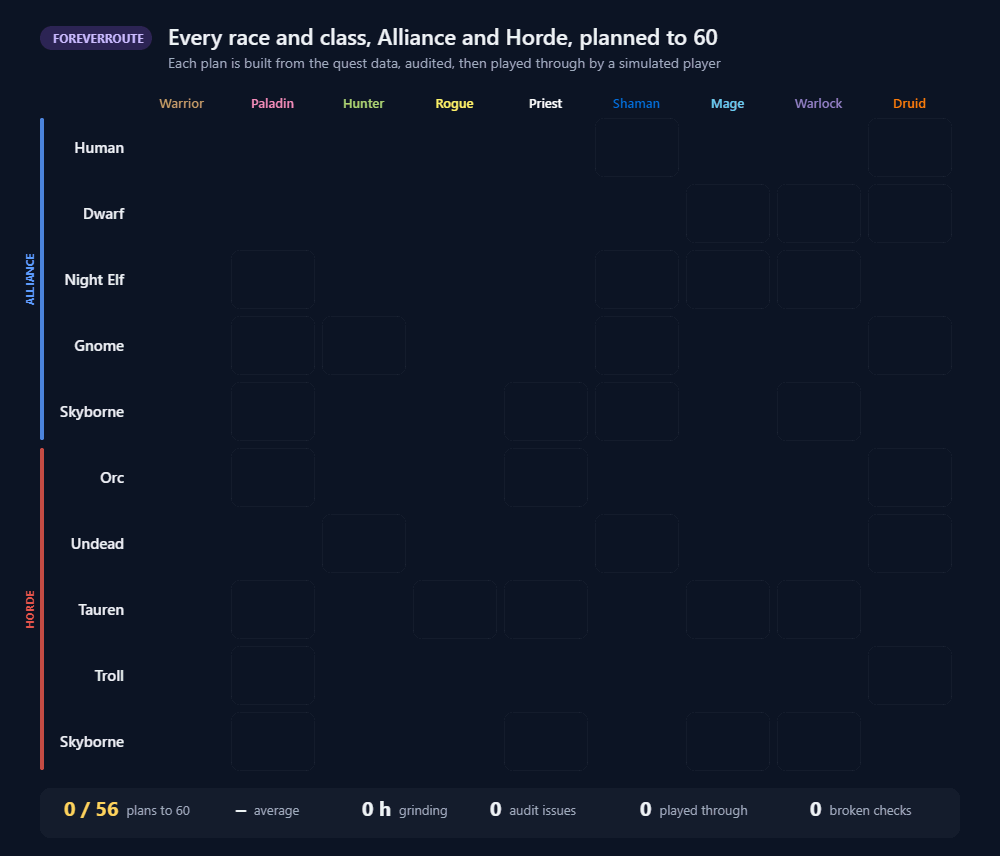

# Forever Route

**Leveling routes for WoW Forever, 1-60, for every race and class, Alliance and Horde.**

A step card, a waypoint arrow and map pins tell you exactly what to do next: what to accept, what to kill or collect, where to hand in, when to train, and how to get to the next zone. It reads your quest log live, so steps tick themselves off as you play. Skip a quest or a dungeon and the route keeps up, and it works at any level: install it at 30 and it starts you on the best part of the plan for where you are.

## What you get

- **A built-in plan for every race and class combination, Alliance and Horde (51 in all)**, from level 1 to 60, through Forever's new zones (Riverglades, Shen'dralas)
- **Class quests built in**, such as Redemption and the Warhorse for paladins, warlock pets, druid forms, shaman totems, warrior stances and rogue poisons
- **The step card**: the next thing to do, with kill and loot counters and the next few steps; inside a dungeon it shows that dungeon's quests with live progress
- **A target key**: one key targets the step's NPC and marks it with a star (Keybindings > AddOns > Forever Route Targeting)
- **The waypoint arrow and map pins**, which walk you to every stop, along the roads and around hostile camps
- **Travel that knows the world**: flight paths, boats, zeppelins, the tram, hearthstone, mage and druid teleports, and the Skyborne skyship; a long walk becomes a flight when that's clearly faster
- **Hand-ins while you're there**: finish a quest early and the card sends you to its hand-in when you pass by
- **Optional quest automation**: accept your route's quests and hand in finished ones (never when there's a reward to choose)
- **Best-reward hints** on quest turn-in
- **Readable on any screen**: one size setting for everything, with a suggestion on 4K and ElvUI setups

## How the routes are made

Routes aren't hand-written. A planner builds them from the quest data and the game's own terrain. It plans out every zone that fits your level, picks the best next zone by xp per hour, finds the fastest way there, and keeps only the quests worth doing. Dungeons are never forced on you: where the quests run out, it grinds a level instead. Every plan is then played from 1 to 60 by simulated players before it ships.

**It keeps the quests worth doing**, and says why the rest were cut:

**It finds the fastest way there** across roads, boats, the tram, flights, class teleports and the Skyborne skyship:

## Getting started

Install, log in, and the plan for your race and class loads by itself. Open any flight master's map once so the addon knows your flight paths. `/fr` toggles the card, `/fr list` shows the whole route, and `/fr options` has the settings (size, quest automation and more).

Something look wrong? Type `/fr report` and paste what it gives you, with a screenshot, into an issue on GitHub. It's anonymous: no character name, realm or account.

Works alongside Questie.

## Links

- Source, issues and what's new in each version: https://github.com/noopz/ForeverRoute
